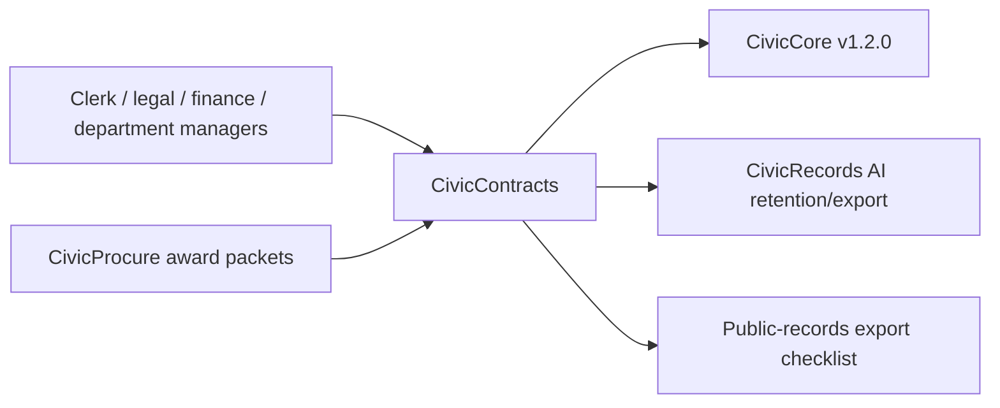

# CivicContracts User Manual

## For Non-Technical Users

CivicContracts helps city staff keep contract records, clause topics, expiration dates, renewal notes, public-records review notes, draft review queues, and export manifests organized. It can create a sample contract registry stub, create a review-required contract draft from CivicProcure award packet identifiers, flag clause topics, build expiration reminders, summarize renewal visibility, and assemble a public-records export checklist.

Current state: `0.1.1` local-first contract drafting and registry runtime. CivicContracts saves contract registry, renewal visibility, contract draft, and staff review queue records in a default local SQLite database. CivicContracts does not provide official legal interpretation, legal advice, live contract management platforms, live LLM calls, contract execution workflows, executed signatures, renewal approvals, or contract system-of-record updates. Staff own every decision.

## For IT and Technical Staff

CivicContracts is a FastAPI Python package pinned to the published `civiccore v1.2.0` release wheel. The current runtime exposes:

- `GET /`
- `GET /health`
- `GET /ready`
- `GET /api/v1/civiccontracts/readiness`
- `GET /civiccontracts`
- `GET /civiccontracts/staff`
- `GET /api/v1/civiccontracts/integration-contracts`
- `POST /api/v1/civiccontracts/registry`
- `GET /api/v1/civiccontracts/registry/{contract_id}`
- `POST /api/v1/civiccontracts/drafts/from-procurement`
- `GET /api/v1/civiccontracts/drafts/{draft_id}`
- `POST /api/v1/civiccontracts/clauses/lookup`
- `POST /api/v1/civiccontracts/expirations`
- `POST /api/v1/civiccontracts/renewals/summary`
- `GET /api/v1/civiccontracts/renewals/{contract_id}`
- `POST /api/v1/civiccontracts/export`
- `GET /api/v1/civiccontracts/staff/reviews`

Run:

```bash
python -m pip install -e ".[dev]"
python -m pytest -q
bash scripts/verify-release.sh
```

CivicContracts uses `CIVICCONTRACTS_DATA_DIR` for its default local SQLite-backed registry database, or `CIVICCONTRACTS_REGISTRY_DB_URL` when IT needs an explicit SQLAlchemy database URL. Staff queue routes also require `CIVICCONTRACTS_STAFF_API_KEY`, `X-CivicContracts-Role: staff`, and `X-CivicContracts-Staff-Key` matching the configured key.

## Architecture



CivicContracts depends on CivicCore. CivicCore does not depend on CivicContracts. CivicContracts v0.1.1 uses local-first staff-gated persistence, review-required contract drafts for CivicProcure award/RFP references, staff review queue records, and public-records export checklists. Live contract management platforms, executed signatures, legal advice, and production contract-system integrations are future work.
